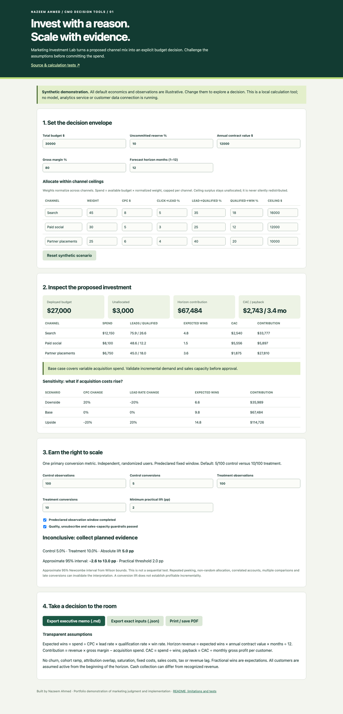

# Marketing Investment Lab

A practical CMO decision tool: should this channel mix receive budget, what breaks in the downside case, and does an experiment justify scaling?

**[Live demo](https://zandemha2025.github.io/marketing-investment-lab/)** · Built by Nazeem Ahmed. All defaults are synthetic demonstration data. No customer results, benchmarks, adoption or business impact are claimed.



## The executive decision

Set budget, reserve, annual contract value, gross margin and horizon. Allocate normalized weights within explicit channel ceilings. Inspect expected customers, CAC, payback and contribution, then compare downside/base/upside economics. Unspent ceiling surplus remains unallocated. This is a constrained worksheet; it does not pretend to optimize a nonlinear budget response curve.

The experiment uses independent randomized binary observations and an approximate 95% Newcombe interval built from Wilson score bounds. The default 5/100 versus 10/100 is **inconclusive**, despite a doubled observed rate. A positive verdict requires a completed fixed window, passing guardrails and an interval above the minimum practical absolute lift.

Export the executive memo with exact inputs, channel decisions, sensitivity cases, observation counts and limits. Export the scenario JSON or print to PDF. Inputs stay in browser memory until export; reload clears edits.

## Transparent implementation

Buildless HTML/CSS and browser ES modules; no dependencies, API keys, model, account or analytics connection. `model.js` is the pure deterministic engine, `app.js` binds the form, and `ui.js` produces local Blob downloads. Invalid inputs block exports and clear the forecast. Dynamic channel names are escaped for HTML. GitHub Pages hosts the public demo without custom DNS.

Calculations:

- Spend = min(budget × (1 − reserve) × normalized weight, channel ceiling).
- Customers = spend ÷ CPC × click-to-lead × qualification × win rate.
- Revenue = customers × annual contract value × horizon months ÷ 12.
- Contribution = revenue × gross margin − media spend.
- CAC = spend ÷ expected customers; payback = CAC ÷ monthly gross profit/customer.

The interval method follows [Newcombe's comparison of eleven methods](https://pubmed.ncbi.nlm.nih.gov/9595617/), using the score-based difference interval without continuity correction. This implementation is an approximate decision aid, not a substitute for reviewing the experimental design.

## Run and test

Requires Node 20+ for tests and Python 3 for local serving. No dependency install.

```sh
npm test
npm start
# open http://localhost:8101
```

Thirteen deterministic tests cover funnel identities, budget conservation, caps, zero-spend arithmetic, downside sensitivity, invalid economics/counts, observation/guardrail gates, inconclusive small samples, strong lift, interval symmetry/boundaries and memo reproducibility. CI runs on each push and pull request. [Browser verification](docs/QA.md) records actual live checks; [two-minute demo script](docs/DEMO.md).

## Real limitations

All customers are assumed active at the start of the horizon. No cohort ramp, churn, sales costs, fixed costs, tax, cash-collection lag, attribution overlap or saturation. Fractional customers are expectations. A forecast is not causal incrementality. Check sales capacity, actual pipeline quality and revenue timing before approval.

The experiment does not correct for repeated peeking, multiple comparisons, clustered accounts, non-random assignment or delayed conversions. Small samples remain uncertain. A successful conversion test does not establish profitable revenue impact. No data is stored remotely or sent to other systems.

## Shipping record

Commits use real current timestamps and describe work actually completed. This project was built for the portfolio in October 2026; no historical shipping cadence is implied. MIT license.
